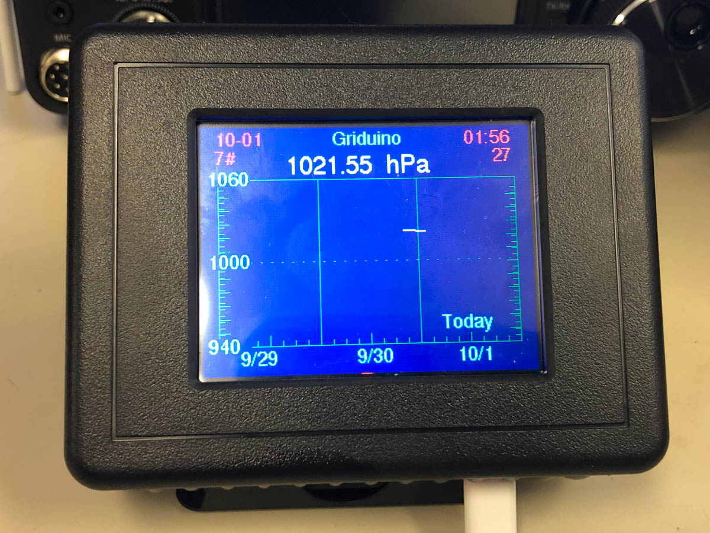

# Baroduino

A graphing 3-day barometer. What can you do with a barometer that knows the time of day? Graph it!

Baroduino is a standalone example program for the Griduino hardware. It reads its internal barometric sensor, timestamps each reading using the GPS clock, saves a history in flash memory, and graphs the most recent 3 days of barometric pressure on the TFT display.



The barograph feature was merged into the main Griduino program in February 2021. This sketch remains as a smaller, self-contained example of the same technique.

## Features

* Shows current barometric pressure, updated every 5 minutes
* Graphs 3 days of pressure history at 4 pixels per hour
* Auto-scales the vertical axis to fit the data
* Logs a reading every 15 minutes, on the quarter hour
* Keeps the history in non-volatile flash memory and redraws it on power-up
* Sets its clock from the GPS satellite network (always UTC)
* Tap anywhere on the touchscreen to switch between English (inHg) and metric (hPa); the setting is saved

## Display Layout

```
+---------------------------------------+
| date          Baroduino         hh:mm |
| #sat         29.97 inHg            ss |
|  30.5+-----------------------------+  |
|      |         |         |         |  |
|      |         |         |         |  |
| 30.0 +  -  -  -  -  -  -  -  -  -  +  |
|      |         |         |         |  |
|      |         |         |  Today  |  |
| 29.5 +-----------------------------+  |
|         10/18     10/19     10/20     |
+---------------------------------------+
```

## Hardware

The sketch only compiles for the SAMD51 (Feather M4 Express) and Griduino PCB. Pin assignments are in [hardware.h](hardware.h). 

## Software Libraries

Install these with the Arduino Library Manager:

* Adafruit ILI9341
* Adafruit GPS Library
* Adafruit NeoPixel
* Adafruit BMP3XX Library
* Adafruit SPIFlash
* SdFat - Adafruit Fork
* Time, by Paul Stoffregen (https://github.com/PaulStoffregen/Time)
* Resistive_Touch_Screen, by Barry Hansen, replacing Adafruit_TouchScreen (https://github.com/barry-ha/Resistive_Touch_Screen)

## Files

| File | Purpose |
|---|---|
| [Baroduino.ino](Baroduino.ino) | Main program: display, graph, touch, setup and loop |
| [model_baro.h](model_baro.h) | Barometer model: reads the sensor, keeps the 3-day history, saves and loads it |
| [save_restore.h](save_restore.h), [save_restore.cpp](save_restore.cpp) | Read and write files on the Feather's flash memory |
| [TextField.h](TextField.h), [TextField.cpp](TextField.cpp) | Draw text on the TFT without flicker |
| [constants.h](constants.h) | Griduino constants, colors, typedefs |
| [hardware.h](hardware.h) | Pin definitions |
| [date_helper.h](date_helper.h) | Date validation and next-time-mark helpers |
| [logger.h](logger.h) | Conditional logging to the Serial console |

## How It Works

### Units of pressure

The BMP3xx sensor reports pressure in Pascals.

* 100 Pascals = 1 hPa = 1 millibar
* 1 inch Hg = 3386.39 Pascals

So a reading of 100734 Pa divided by 3386.39 is 29.72 inHg. The sensor's relative accuracy is about 8 Pascals, or roughly ±0.5 meter of altitude.

### Clock

The real-time clock inside the Ultimate GPS is set once it receives satellite data, and it keeps time as long as its coin cell battery is installed, even without a current GPS fix. Baroduino copies the GPS time into the Arduino clock once per second. No readings are logged until the clock has a valid date. The time is always UTC.

### Pressure history and flash wear

Readings are stored in `/Griduino/barometr.dat` on the Feather's flash chip. Each reading is 8 bytes (timestamp and pressure). To reduce wear on the flash memory:

* Every 15 minutes, one reading is **appended** to the end of the file, instead of rewriting the whole history.
* The file is fully rewritten only when it is missing, has an old header, or grows to 2 × 384 records. That happens about once every 4 days, and the file stays under about 6.2 KB.
* On power-up, the most recent 384 readings (4 days) are loaded back into memory.

The English/metric setting is saved in `/Griduino/barogrph.cfg`.

## Using It

1. Open `Baroduino.ino` in the Arduino IDE, select the Feather M4 Express board, and upload.
2. Open the Serial Monitor at 115200 baud to watch the startup log (optional).
3. Put the GPS antenna where it can see the sky. The graph starts filling in after the clock is set.
4. Tap the screen to change units.

## Credits

* Software: Barry Hansen, K7BWH, Seattle, WA
* Hardware: John Vanderbeck, KM7O, Seattle, WA
* Created 2019-12-18 from an example by John KM7O
